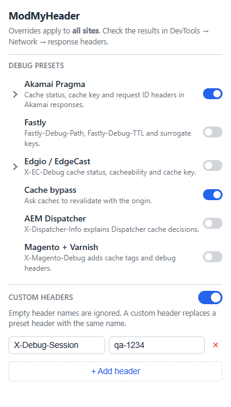

# ModMyHeader

A Chrome extension (Manifest V3) for **debugging websites by changing the
request headers your browser sends**. It has one-click toggles for common CDN
and cache debug headers such as Akamai Pragma, and it also lets you send any
custom header you like.

  

## Key features

- **Debug presets**: switch CDN/cache debug headers on and off with one click
  (Akamai, Fastly, Edgio, AEM, Magento, cache bypass).
- **Pick individual directives**: expand Akamai or Edgio (›) to choose exactly
  which debug directives are sent.
- **Custom headers**: add any number of `name → value` pairs, with their own
  on/off switch so you can pause them without deleting your list.
- **Works everywhere**: applies to every site and every request type (page
  loads, fetch/XHR, images, scripts and so on).
- **Instant**: changes apply right away, with no reload needed.
- **Remembers your settings** across browser restarts.
- **ON badge** on the toolbar icon whenever any header is being sent.

## Install (developer mode)

1. Download or clone this repository.
2. Open `chrome://extensions` in Chrome.
3. Turn on **Developer mode** (top-right corner).
4. Click **Load unpacked** and select the project folder.
5. Pin ModMyHeader from the puzzle-piece menu so the icon stays in your toolbar.

## How to use

1. Click the ModMyHeader icon to open the popup.
2. Turn on a **debug preset**, add **custom headers** and switch them on, or
   do both.
3. Reload the page you're debugging.
4. Open **DevTools → Network**, select a request and look at its
   **Response Headers** to see the debug information.

Remember to switch everything off when you're done. The headers go to **all
sites**, and the ON badge reminds you when they're active.

## Debug presets

| Preset | Request header sent | What you get back |
|--------|---------------------|-------------------|
| **Akamai Pragma** | `Pragma: akamai-x-cache-on, akamai-x-cache-remote-on, akamai-x-check-cacheable, akamai-x-get-cache-key, ...` | `X-Cache` (HIT/MISS), `X-Cache-Remote`, `X-Check-Cacheable`, `X-Cache-Key`, `X-True-Cache-Key`, `X-Akamai-Request-ID`, … |
| **Fastly** | `Fastly-Debug: 1` | `Fastly-Debug-Path`, `Fastly-Debug-TTL`, surrogate keys |
| **Edgio / EdgeCast** | `X-EC-Debug: x-ec-cache, x-ec-cache-remote, ...` | Cache status, cacheability, cache key, cache state |
| **Cache bypass** | `Cache-Control: no-cache` and `Pragma: no-cache` | Asks caches to revalidate with the origin |
| **AEM Dispatcher** | `X-Dispatcher-Info: true` | Why Dispatcher did or didn't cache a page |
| **Magento + Varnish** | `X-Magento-Debug: 1` | Cache tags and Varnish debug headers |

**Akamai and Edgio** come with a sensible default set of directives. Click the
› arrow to add or remove individual ones. Akamai's optional extras include the
client IP, TLS session ID and Resource Optimizer trace.

### When headers overlap

- If two presets send the same header, their values are **combined**. For
  example, Akamai Pragma plus Cache bypass sends a single `Pragma` header
  containing both.
- A **custom header with the same name** as a preset header **replaces** the
  preset's value, so custom headers always win.

## Limitations

- Chrome doesn't let extensions override some browser-controlled headers
  (e.g. `Host` and certain `Sec-*` headers).
- Custom header rows with an empty name are ignored.
- Headers are sent to every site. There's no per-domain filtering yet.

## How it works

The extension uses Chrome's
[`declarativeNetRequest`](https://developer.chrome.com/docs/extensions/reference/api/declarativeNetRequest)
API. The popup saves your settings to `chrome.storage.local`. The background
service worker watches that storage and rebuilds a single dynamic rule that
**sets** each header, adding it or replacing any existing value.

| File | Purpose |
|------|---------|
| `manifest.json` | Extension manifest (MV3, permissions). |
| `background.js` | Service worker that turns saved settings into the header rule. |
| `presets.js` | Debug preset definitions, shared by the worker and the popup. |
| `popup.html` / `popup.css` / `popup.js` | The popup UI. |
| `docs/` | README images. |

### Adding a preset

Add an entry to the `PRESETS` array in `presets.js`. Use `headers` for fixed
`name`/`value` pairs, or `list` for a single header built from directives the
user can check. The popup and the service worker both pick it up
automatically.
